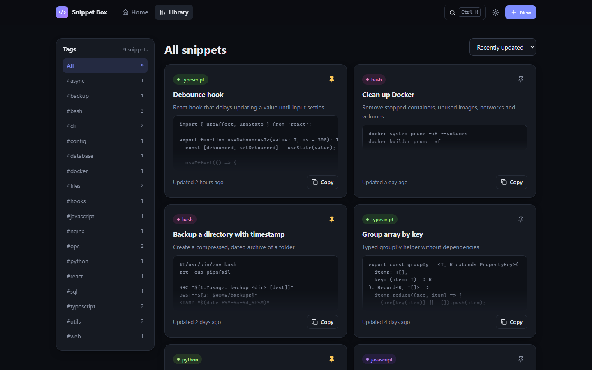
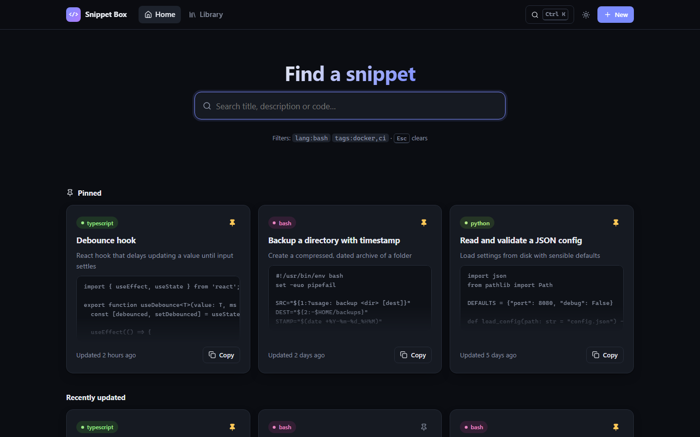
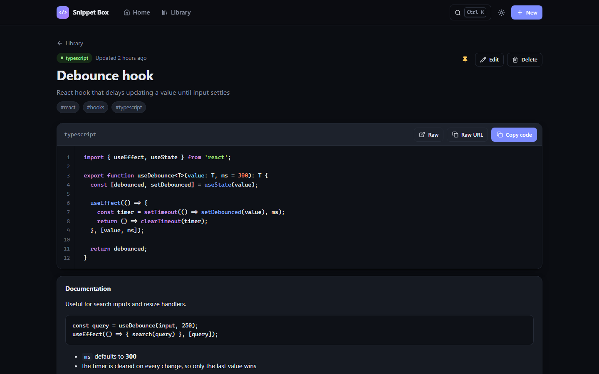
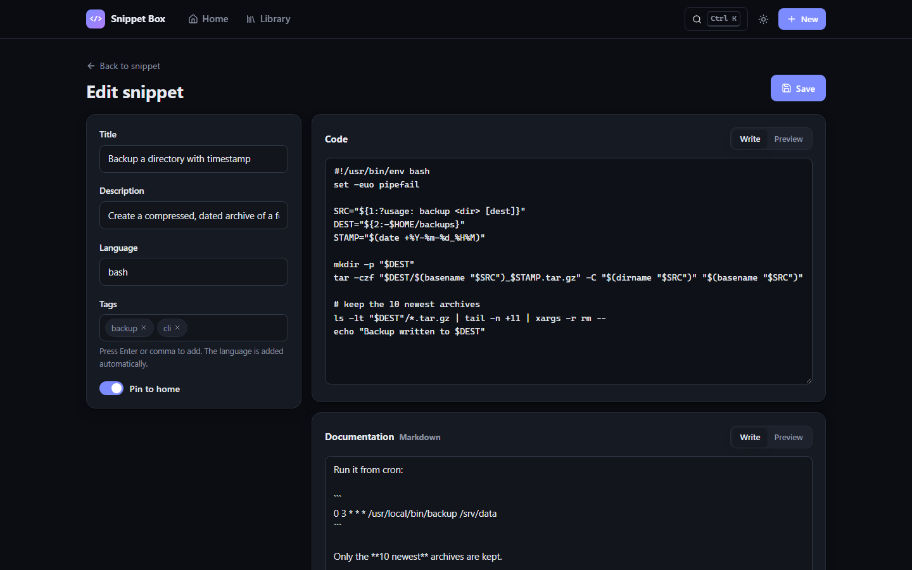

# Snippet Box

> **Fork notice:** This is a security-hardened and modernized fork of
> [pawelmalak/snippet-box](https://github.com/pawelmalak/snippet-box) by Paweł Malak,
> maintained by [joe128](https://github.com/joe128). It is not affiliated with or endorsed by
> the original author. See [Security](#security) for what changed.



## Description

Snippet Box is a simple self-hosted app for organizing your code snippets. It allows you to easily create, edit, browse and manage your snippets in various languages. With built-in Markdown support, Snippet Box makes it very easy to add notes or simple documentation to your code.

## Security

This fork hardens Snippet Box against **Broccoli2Shell / Node2Shell (CVE-2026-111497)**, the
out-of-bounds write in the Brotli decoder bundled with Node.js, plus several app-level issues:

| Issue | Fix |
| --- | --- |
| Broccoli2Shell: unpatched Node 14 runtime | Docker image pinned to `node:24.22.1-alpine`; server **refuses to start** on Node < 22.23.4 / 24.22.1 / 26.12.1 (`ALLOW_VULNERABLE_NODE=1` to override for local dev only) |
| Broccoli2Shell: attacker-supplied compressed bodies | Every `Content-Encoding` other than identity is rejected with 415 before reaching zlib; `express.json({ inflate: false })` as second layer |
| Stored XSS via `/api/snippets/raw/:id` (served as `text/html`) | Served as `text/plain` with `nosniff` and a sandbox CSP |
| Mass assignment (`...req.body` into the model) | Strict zod schemas, only whitelisted fields are persisted |
| Missing input validation (crashes, operator injection) | Typed validation for bodies and ids, 1 MB body limit |
| No security headers | helmet with a strict CSP, `frame-ancestors 'none'` |
| CSRF on state-changing requests | Fetch-Metadata check + JSON-only content type |
| No authentication | Optional HTTP Basic auth via `AUTH_PASSWORD` / `AUTH_USER` |
| Container ran as root | Multi-stage build, runs as `node`, read-only rootfs in compose |
| Error responses leaked internals | 5xx errors return a generic message |

## Technology

- Backend: Node.js 26 (LTS), TypeScript, Express 5, Sequelize + SQLite, zod, helmet
- Frontend: React 19, Vite, React Router 7, highlight.js (lazy-loaded)
- Deployment: Docker

## Development

Requires Node.js 26 (LTS; 22.23.4+ and 24.22.1+ also work) and [pnpm](https://pnpm.io) 12 (`npm i -g pnpm@12`).

```sh
pnpm install   # server + client (pnpm workspace)
pnpm dev       # API on :5000, Vite dev server on :5173
pnpm build     # compile server to build/, client to client/build/
pnpm start     # run the compiled server
pnpm test      # server + client tests (node:test via tsx)
```

The tests boot the real app against a throw-away SQLite file and cover the API, search,
migrations and the security fixes (compressed bodies, raw-endpoint XSS, validation, CSRF, auth).

## CI / Releases

`.github/workflows/release.yml` runs on every push to `main`, manually, and weekly:

1. **Weekly security check** - scans the published `:latest` image with Trivy and only
   continues when fixable HIGH/CRITICAL vulnerabilities are found.
2. **Tests** (`tests.yml`, also runs on every pull request) - builds the `test` Docker stage (same Alpine + Node as production) and runs
   `pnpm test` and `pnpm audit` inside it, then builds the production image, checks that it
   becomes healthy, rejects Brotli bodies and passes a Trivy scan.
3. **Release** - conventional-commit changelog and version tag.
4. **Publish** - pushes `<version>` and `latest` to Docker Hub.

### Dependency updates

[Renovate](https://docs.renovatebot.com) (`renovate.json5`) opens PRs on Monday mornings,
waits 3 days after a release (pnpm rejects younger packages anyway) and automerges
non-major updates once the **Tests** workflow is green. The commit type decides about a release:

| Updates | Commit | Release |
| --- | --- | --- |
| runtime dependencies, `node` base image, security fixes | `fix(deps)` | patch release + image |
| dev tooling, GitHub Actions, pnpm, lockfile maintenance | `chore(deps)` | none |

Major updates and new Node LTS versions always need a manual merge.


## Installation

```sh
docker compose up -d --build
```

Set `AUTH_PASSWORD` in `docker-compose.yml` before exposing the app beyond localhost.

Data lives in the named volume `snippet-box-data`, which works with rootful and rootless
Docker as-is. The container runs as uid 1000, not root. If you prefer a host folder
(`./data:/app/data`), it has to be writable for uid 1000 *inside* the container:

```sh
# rootful Docker
sudo chown -R 1000:1000 ./data

# rootless Docker - uid 1000 in the container is a subuid on the host,
# so the chown has to happen from inside a container
docker run --rm -v ./data:/data alpine chown -R 1000:1000 /data
```

### Upgrading from v1

The schema is unchanged, existing `db.sqlite3` files keep working. To move a v1 `./data`
folder into the named volume:

```sh
docker compose create
docker run --rm -v ./data:/from:ro -v snippet-box_snippet-box-data:/to alpine   sh -c 'cp -a /from/. /to/ && chown -R 1000:1000 /to'
docker compose up -d
```

## Functionality

- Search
  - Live search over titles, descriptions and code, with `lang:` and `tags:` filters
  - Press <kbd>Ctrl</kbd>+<kbd>K</kbd> anywhere to jump to the search
- Pinned snippets
  - Pin your most-used snippets to the home screen



- Snippet library
  - Browse all snippets, filter by tag and sort by date or title


- Snippet
  - Syntax highlighting with line numbers, Markdown documentation
  - Copy the code or a raw URL (`/api/snippets/raw/:id`, served as plain text) in one click
  - Click a tag to search for all snippets with that tag



- Editor
  - Language suggestions, tag input with autocompletion, live preview for code and docs
  - Dark and light theme



## Usage

### Search syntax

| Query | Finds |
| --- | --- |
| `docker` | snippets with "docker" in title, description or code |
| `lang:bash` | snippets written in bash |
| `tags:ops,ci` | snippets tagged `ops` or `ci` |
| `tags:"disk cleanup"` | tags containing spaces need quotes |
| `prune lang:bash tags:docker` | filters can be combined with free text |

## License

[MIT](./LICENCE.md) - Copyright (c) 2021 Paweł Malak, Copyright (c) 2026 joe128.

Third-party packages keep their own licenses. `pnpm build` (and the Docker image) generates
`THIRD_PARTY_NOTICES.txt` with the license texts of all bundled production dependencies.
